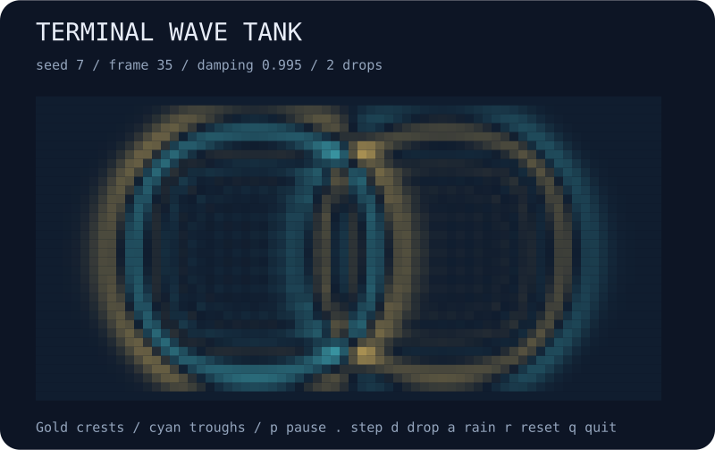

# terminal-wave-tank

Drop ripples into a terminal wave tank. Watch crests and troughs spread, reflect, and interfere. Toggle seeded rain or pause and inspect the field one step at a time.



## Run

```bash
npx --yes github:b69ca/terminal-wave-tank
npx --yes github:b69ca/terminal-wave-tank --rain --seed 137
```

Node.js 20 or newer. No runtime dependencies. Everything runs locally.

## Play

| Key | Action |
| --- | --- |
| `p` or Space | Pause / resume |
| `.` | Pause and advance one step |
| `d` | Add a seeded random pulse |
| `a` | Toggle rain |
| `n` | Reset using the next seed |
| `r` | Reset the current seed |
| `+` / `-` | Faster / slower animation |
| `q` or Ctrl-C | Quit and restore the terminal |

Gold marks positive displacement; cyan marks negative displacement. Brighter symbols indicate greater absolute amplitude. Rain adds a pulse every twelve simulation steps. Reset restores the initial rain option. The seed controls random pulses, while the two initial pulses have fixed positions and signs.

## Capture a moment

```bash
npx --yes github:b69ca/terminal-wave-tank --width 70 --height 34 --steps 35 --svg ripples.svg
npx --yes github:b69ca/terminal-wave-tank --rain --seed 7 --steps 120 --json
npx --yes github:b69ca/terminal-wave-tank --steps 35 > waves.txt
```

## Options

```text
--seed N       unsigned 32-bit seed (default: 7)
--width N      integer from 12 to 120
--height N     integer from 12 to 120
--damping N    velocity retention greater than 0 and at most 1 (default: 0.995)
--steps N      advance before display; 0–10000
--frames N     finite terminal session; 0–100000
--rain         start with rain enabled
--json         print summary statistics
--svg FILE     save a static SVG
--no-color     disable ANSI colors
--help         show usage
```

JSON and SVG can be combined. Neither accepts `--frames`. A finite session shows the starting state first, then advances between frames; paused frames still count. Without a TTY, output is one plain 70 × 34 frame without escape sequences. Live defaults fit the terminal at startup. Specify dimensions to reproduce the same field across terminals. `NO_COLOR=1` disables colors too. Exit codes are 0 for success and 2 for argument or file errors. Quitting restores the screen, cursor, and input mode.

## How it works

A finite-difference wave equation updates a two-dimensional displacement field. With the four-neighbor discrete Laplacian, each interior cell follows:

```text
next = current + damping * (current - previous) + 0.22 * laplacian(current)
```

The outer border stays at zero, causing reflections. The fixed coefficient is within the stability range for the supported damping values. Pulses add the same Gaussian-shaped displacement to current and previous fields, so they begin with zero velocity. Lower damping dissipates motion; damping 1 removes explicit dissipation. Continuous rain adds energy.

This is a toy wave field, not a fluid simulation. There are no physical units, advection, viscosity, or water depth. The display saturates at absolute amplitude 0.2 but leaves simulation values untouched. RMS amplitude is a momentary displacement statistic, not total energy, and need not decrease every step.

JSON reports frame, configuration, pulse count, RMS amplitude, and maximum absolute amplitude. It omits the full field.

## Library

```js
import { createTank, drop, step, analyze, renderSVG } from 'terminal-wave-tank';
const tank = createTank({ width: 70, height: 34 });
drop(tank, 20, 10, 1); // Interior coordinates; amplitude must be between -5 and 5.
step(tank, 35); // Mutates and returns the tank.
console.log(analyze(tank));
const svg = renderSVG(tank);
```

`current` and `previous` are row-major `Float64Array` fields: index `y * width + x`. `randomDrop()` uses the tank's local seeded PRNG. Renderers accept tanks created by `createTank()`.

## Development

```bash
npm ci
npm run check
```

Tests cover reproducible rain, symmetry, fixed boundaries, long-run stability, damping, pulse cancellation, CLI behavior, and SVG exports. CI runs on Node.js 20, 22, and 24.

## License

MIT
